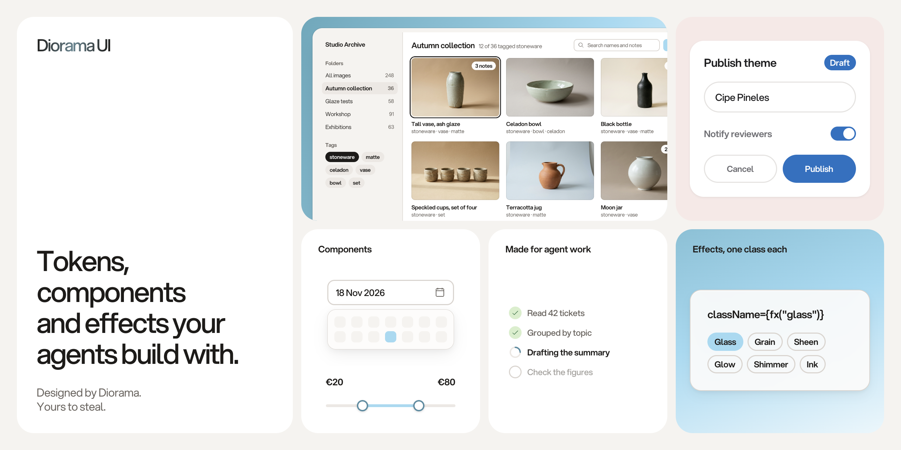

<p align="center">
  <a href="https://ui.bydiorama.com">
    
  </a>
</p>

<h1 align="center">Diorama UI</h1>

<p align="center">
  <strong>Design tokens, React components and the tooling that keeps every app in sync. You install it as source and own it from there.</strong>
</p>

<p align="center">
  <a href="https://github.com/bydiorama/ui/actions/workflows/ci.yml"></a>
  <a href="LICENSE"></a>
  <a href="https://react.dev"></a>
  <a href="package.json"></a>
</p>

<p align="center">
  <a href="https://ui.bydiorama.com/components/">Components</a> ·
  <a href="https://ui.bydiorama.com/docs/">Docs</a> ·
  <a href="#quick-start">Quick start</a> ·
  <a href="#built-for-agents">Agents</a> ·
  <a href="https://ui.bydiorama.com/changelog/">Changelog</a> ·
  <a href="CONTRIBUTING.md">Contributing</a>
</p>

> [!NOTE]
> Diorama UI is in active development. The tokens, 60 components and the
> first three blocks ship today, and a real app consumes them. APIs can still
> change. [`PLAN.md`](PLAN.md) tracks what is done and what is open.

## Why this exists

- **You own the source.** You install a component and its code is yours from
  that point on. There are no wrapper layers and no upgrades to chase.
  ([ADR 0001](ledger/decisions/0001-source-distribution.md))
- **The design is our own.** No third-party design language, block set or
  theme preset is copied in. Base UI supplies accessible behaviour under some
  components, and nothing of its look.
  ([ADR 0002](ledger/decisions/0002-independence.md))
- **Drift is tracked.** A lockfile records what you installed. `sync` then
  tells a deliberate fork apart from a stale copy, and lists the changes that
  apply to you.
- **Measured.** Contrast is computed from the token resolver in both colour
  schemes. Every story runs through axe, and every component is compared
  against visual baselines with zero tolerated pixels.
  ([what CI enforces](CONTRIBUTING.md#what-ci-enforces))
- **Agent-ready.** The library ships [`AGENTS.md`](AGENTS.md), a plugin of ten
  skills and a Markdown reference for every component.

## Quick start

You need a React app with Tailwind CSS v4 and an `@/*` alias that points to
your source directory.

1. **Install the theme, the font and a component.** The CLI writes the source
   into your app, records what it installed and lists the npm packages you
   still need to add.

   ```bash
   npx @bydiorama/ui init --src src
   npx @bydiorama/ui add theme-zero-css font-aspekta button
   ```

2. **Load the theme** once, after Tailwind, from `src/styles/theme-zero.css`.
   Link `/fonts/aspekta/aspekta.css` in your page as well.

   ```css
   @import "tailwindcss";
   @import "./theme-zero.css";
   ```

3. **Use it.** The code is yours to read and change.

   ```tsx
   import { Button } from "@/ui/button";

   <Button variant="primary" size="md">
     Save changes
   </Button>;
   ```

4. **Stay in sync.** `sync` reports what changed upstream, item by item, and
   leaves your edits alone.

   ```bash
   npx @bydiorama/ui sync
   ```

The guides cover the rest:

| Guide | What it covers |
| --- | --- |
| [Installing components](docs/guide/install.md) | The CLI, the shadcn-compatible alternative, installing from a checkout, GitHub API limits |
| [Tokens and themes](docs/guide/theme.md) | Theme zero, how Tailwind finds the installed source, generating a brand theme from a seed |
| [Dense screens](docs/guide/density.md) | Compact mode with one attribute, and what it changes in each control |
| [Lint the boundaries](docs/guide/lint.md) | The ESLint preset that holds your app to the library's import rules, and checking a screen against its design |
| [CLI reference](packages/cli/README.md) | Every command and flag, and the full drift model |

## What's inside

| Area | What it is |
| --- | --- |
| [`registry/ui`](registry/ui) | 60 components: controls, overlays, navigation, chat, charts and data display. Each has source, docs, stories, browser tests and type tests |
| [`registry/lib`](registry/lib), [`registry/hooks`](registry/hooks) | Utilities and hooks, distributed the same way |
| [`registry/lib/fx`](registry/lib/fx), [`registry/lib/shader`](registry/lib/shader) | Effects: glass, grain, sheen, glow, shimmer and ink as one class each, plus an optional WebGL gradient ground. Experimental |
| [`packages/tokens`](packages/tokens) | `@bydiorama/tokens`: the token contract, an OKLCH theme resolver, CSS, Tailwind and TypeScript emitters, and measured contrast |
| [`packages/cli`](packages/cli) | The CLI: `init`, `add`, `lock`, `sync` and `theme` |
| [`apps/storybook`](apps/storybook) | Stories, interaction tests, accessibility checks and the visual-regression runner |

[View all components →](https://ui.bydiorama.com/components/)

## Built for agents

Your coding agent can learn the library's rules, so it builds with the system
and not around it.

| What | Where |
| --- | --- |
| Skills plugin | Ten skills for Claude Code, claude.ai and Cowork. See [`plugins/ui`](plugins/ui/README.md) |
| Library index | [`llms.txt`](https://ui.bydiorama.com/llms.txt), and the whole reference in [`llms-full.txt`](https://ui.bydiorama.com/llms-full.txt) |
| Repository rules | [`AGENTS.md`](AGENTS.md) and [`CONVENTIONS.md`](CONVENTIONS.md) |
| Checks with no install | `pnpm verify` runs on a fresh clone, before `pnpm install` |

Install the plugin in Claude Code:

```
/plugin marketplace add bydiorama/ui
/plugin install ui@diorama-ui
```

In claude.ai or Cowork, open **Customize › Plugins › Add › Add marketplace**,
enter `bydiorama/ui`, then add `ui`.

## Documentation

- [ui.bydiorama.com](https://ui.bydiorama.com): components, docs and changelog.
- [`CONVENTIONS.md`](CONVENTIONS.md): the component API rulebook. Binding.
- [`PLAN.md`](PLAN.md): where the library is and what each phase still needs.
- [`TODO.md`](TODO.md): defects, undrawn components and open design questions.
- [`ledger/decisions/`](ledger/decisions/): why things are the way they are.
  Read these before re-proposing a settled question.

## Contributing

[`CONTRIBUTING.md`](CONTRIBUTING.md) has the development commands, the
repository layout and what CI enforces. Every change that affects consumers
needs a [ledger entry](ledger/entries/).

## License

MIT. See [LICENSE](LICENSE). Adapted third-party material is itemised in
[CREDITS.md](CREDITS.md). Licensed typefaces are the one asset class that is
not MIT-distributable, and `pnpm check:licensing` keeps them out of the tree
([ADR 0003](ledger/decisions/0003-typography-licensing.md)).
