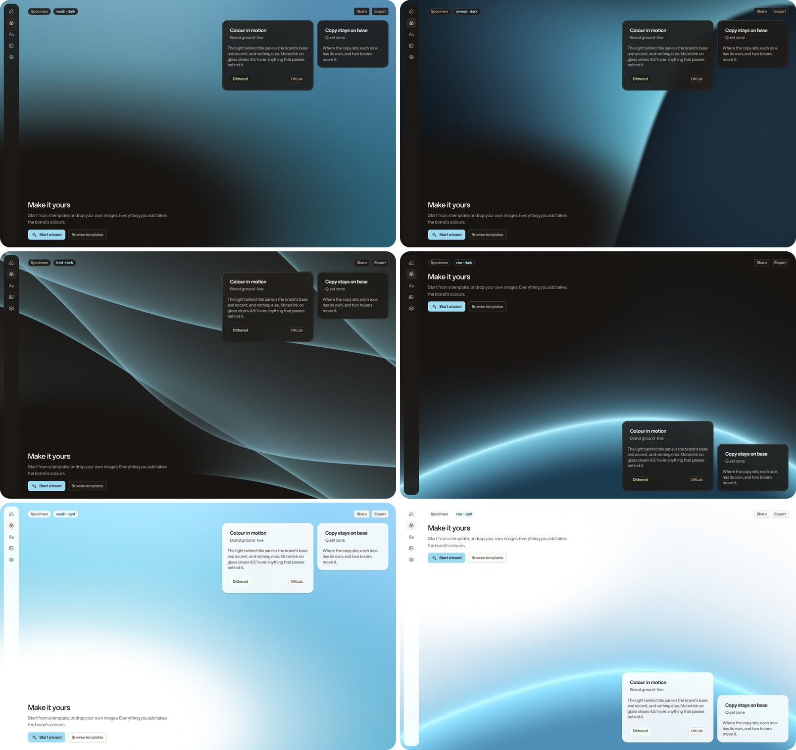
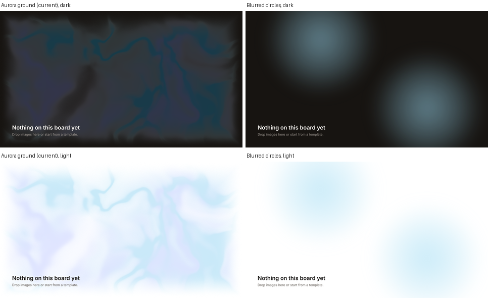
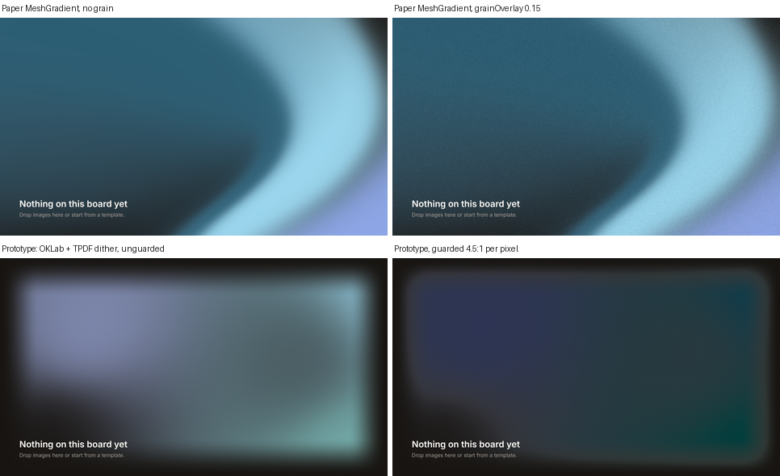
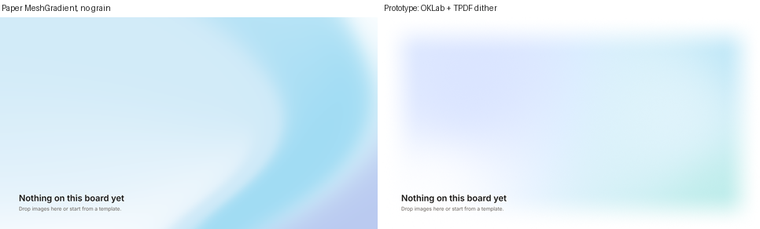
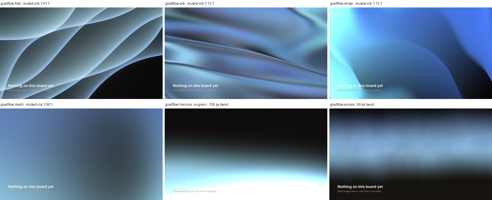
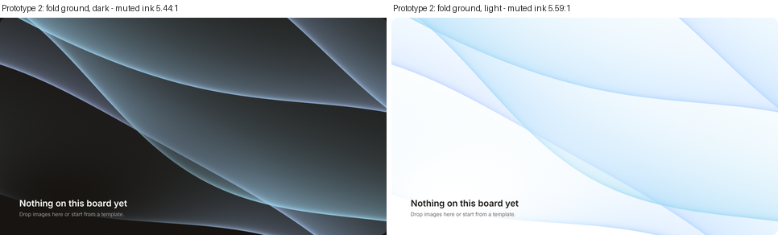
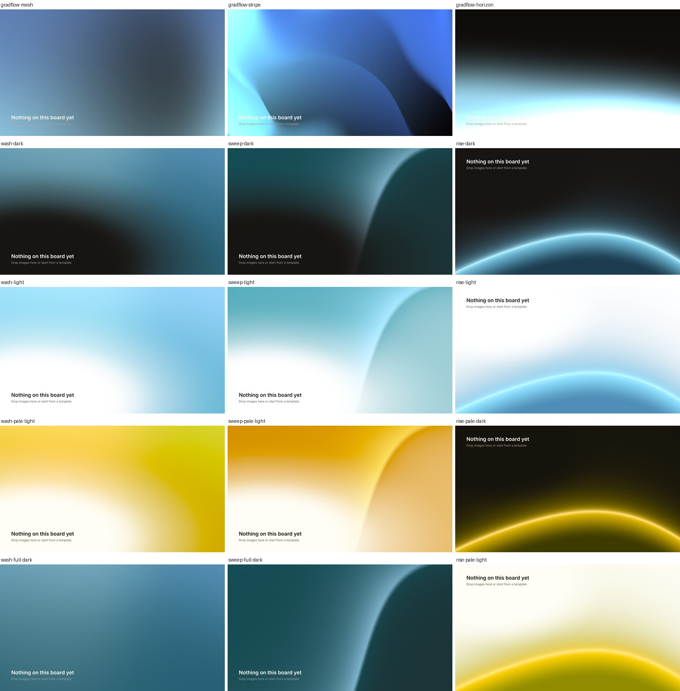

# WebGL gradients for grounds — research

Status: **implemented**, 2026-11-22, as
[ADR 0025](../ledger/decisions/0025-grounds-replace-aurora.md).

- Aurora is retired.
- `fx("mesh")` and `fx("fold")` ship in the `shader` item, written from
  scratch. gradflow and MagicPattern were a benchmark only.
- The testing specimen is the Storybook story **Effects/Specimen**: the
  grounds under glass, in both schemes and under the stress brand.



What follows is the research that led there. It answers one question: the
generated grounds look poor, so should the effects layer move to WebGL
(mesh) gradients? The prototypes in the lab differ from the shipped
programs in their hue turns. A wide turn sent the pale-yellow brand's fold
to green, so the shipped grounds drift by 20–24° only.

Everything measured here comes from the lab in
[`webgl-gradients/lab/`](./webgl-gradients/lab/). The lab renders the shipped
aurora GLSL directly from `registry/lib/shader/shader-programs.ts`, the
blurred-circles ground, Paper's MeshGradient and a prototype, all under the
same conditions: 960×540 at 1× DPR, theme zero, and the Ground story's copy
(`text-ink-primary` + `text-ink-muted`).

## Short answer

**Yes to mesh gradients, but write them into our own shader runtime. Do not
adopt a gradient library.** Also, the technique is only part of why today's
grounds look bad. Four of the five causes below would make a mesh gradient
look just as bad if we carried them over:

1. no real dither, so 8-bit ramps band;
2. a per-pixel contrast guard that squeezes a dark ground into a few
   luminance levels;
3. fbm "ribbons", whose mid-frequency detail reads as veins and dirt;
4. a dissolve that fades by the box's distance field, which creases along the
   diagonals;
5. (blurred circles only) a layout of two spots on black, with nothing in
   between.

A mesh gradient fixes (3) and (5) by its nature. (1), (2) and (4) we have to
fix ourselves, whatever technique we choose.

**Update after the references (§5).** gradflow and MagicPattern point at a
*directional* "fold/silk" look rather than a soft mesh. A second prototype in
that family holds the muted text at 5.4:1 in both schemes, with a quiet zone
under the copy instead of a per-pixel guard. So the recommendation becomes
**one ground with two looks: `mesh` (quiet) and `fold` (expressive)**.

## 1. What is wrong today, measured



How to read the table:

- **Levels** = the number of distinct luminance values in a 720×240 band of
  the ground.
- **Max run** = the widest stretch of identical pixels (px) along a row that
  is not flat. On a gradient, a wide run *is* a band.

| Tile | Levels | p95 run | Max run |
|---|---:|---:|---:|
| Aurora ground, dark | 23 | 9 | 103 |
| Aurora ground, light | 26 | 3 | 24 |
| Blurred circles, dark | 89 | 4 | 284 |
| Blurred circles, light | 24 | 4 | 284 |

**Banding.** 8-bit output has few code values near black. One step at sRGB
20→21 is a ~7% jump in luminance; at 200→201 it is ~1%. So a slow dark ramp
splits into wide, visible bands. Blurring cannot bring back levels that 8-bit
storage has already thrown away. KDE and Windows Acrylic both add noise
*after* the blur for exactly this reason ([frost.kiwi][frost]). The aurora's
grain is uniform white noise of ±1.5/255. That is the wrong distribution and
it is applied in the wrong place:

- Playdead (INSIDE) use triangular-PDF noise, ±1 LSB, applied in the space the
  value is quantised in, i.e. after the sRGB encode ([Playdead][inside],
  [Wronski][wronski]).
- The aurora adds its grain *before* `fx_guard`, and the guard then rescales
  it.

Without a dither, the lab's own mesh gradient bands too: the max run goes
16 → 84 px on dark and 22 → 212 px on light. **Dither is the single
biggest quality lever, whatever the technique.**

**The guard crushes dark grounds.** `fx_guard` keeps every pixel at 4.5:1
against `--ui-text-muted`. On a button that is right: the label sits
everywhere on the fill. On a ground, it means no pixel anywhere may rise much
above the base. The light gets squeezed into the bottom of the range, which
is where the muddy grey-teal comes from. The same prototype has 68 levels
unguarded and **5** guarded. See the right-hand pair of figure 2.

**fbm ribbons.** `fx_auroraMasks` draws light along level lines of four-octave
fbm noise warped by more fbm. The octaves add mid- and high-frequency
mottling. The thin cores (`exp(-(x/0.032)²)`) are what read as cracks or
veins. A mesh gradient is low-frequency by construction: the GPU interpolates
between a few colour points. Stripe's gradient even clamps its noise into a
few broad layers ([Stripe gradient, annotated][stripe]).

**The mitre crease.** The dissolve fades by `fx_shapeDistance`, a rounded
box's signed distance field. That field has a ridge along each diagonal, so
any fade built on it draws an **X-shaped crease into the corners**. It is
visible in the aurora tiles, and the first version of the prototype
inherited it. The fix is a separable falloff: the product of two 1D
smoothsteps, which is smooth everywhere.

**Blurred circles.** Besides having no dither, a large blur of a radial
gradient leaves a faint dark ring around each circle (figure 1, top right).
Two circles also give the eye two spots and a void, not a field.

## 2. What "WebGL gradients" are

Three techniques have real traction:

| Technique | Example | How it works |
|---|---|---|
| Per-pixel colour points | Paper `MeshGradient` | A full-screen fragment shader. Each pixel blends N moving colour points by inverse distance (Paper: weight = 1/d^3.5), after a sine/swirl domain warp. |
| Vertex-displaced plane | Stripe homepage (minigl) | A subdivided plane, deformed by simplex noise in the vertex shader. Colour waves are layered per vertex and the GPU interpolates them. |
| Lit 3D mesh | ShaderGradient | three.js: a plane, sphere or water surface with lighting and a camera. |

The first one fits our runtime. Our runtime draws one full-viewport triangle
per part, with no buffers. Per-pixel colour points need nothing more. The
other two need meshes, and the third needs three.js.

## 3. Libraries and licences

The hard boundary is **no licensed or paid assets**. These licences were
checked against the npm registry and the published tarballs on 2026-11-22.

| Library | Licence | Can we use it? |
|---|---|---|
| `@paper-design/shaders` ≥ **0.0.77** | **Apache-2.0** (+ NOTICE: "Paper Shaders, Copyright 2026 Paper") | Yes. Ship the LICENSE, keep the NOTICE, mark the files we changed. |
| `@paper-design/shaders` 0.0.47–0.0.76 | PolyForm Shield 1.0.0 ("SEE LICENSE IN …") | **No.** Not OSI, and it forbids competing products. |
| `@paper-design/shaders` ≤ 0.0.46 | MIT | Yes, but old. |
| Stripe minigl, whatamesh | No licence | **No.** |
| `@mesh-gradient/core` | Declares MIT, but bundles Stripe's `MiniGl`, `u_vertDeform`, `u_waveLayers` | **No.** The code appears to come from Stripe. |
| ShaderGradient (ruucm) | MIT | Licence is fine, but it needs three + @react-three/fiber: far too heavy for a ground. |
| Neat (FireCMS) | MIT + Commons Clause, with a paid watermark key | **No.** |
| Granim.js | MIT | Canvas 2D gradient transitions, last released 2018. Not a mesh gradient. |

Paper is already in the studio's workflow: the motion sources in
`design/motion/*/source/*.jsx` use its `DotGrid`. So it is the natural
reference.

## 4. Paper's MeshGradient beside a prototype





| Tile | Levels | p95 run | Max run |
|---|---:|---:|---:|
| Paper MeshGradient, dark, no grain | 129 | 20 | 219 |
| Paper MeshGradient, dark, `grainOverlay: 0.15` | 137 | 2 | 5 |
| Paper MeshGradient, light, no grain | 27 | 51 | 408 |
| Prototype, dark (OKLab, TPDF dither) | 68 | 3 | 16 |
| Prototype, dark, no dither | 66 | 11 | 84 |
| Prototype, dark, guarded 4.5:1 | 5 | 3 | 16 |
| Prototype, light | 16 | 3 | 22 |
| Prototype, light, no dither | 14 | 52 | 212 |

What the lab shows:

- **Paper's shapes are the best of the set**: bold and clean, with no veins.
  Its default output is not production quality for us, though:
  - It mixes colours in **gamma-encoded sRGB**.
  - It has **no dither**. It bands worst of all: 408 px runs on light.
    `grainOverlay` hides the bands, but as a *visible* grain, which is a
    style choice rather than a fix.
  - It declares `precision mediump float`. Our prelude warns that this is
    fp16 on many phone GPUs.
- **The prototype** is ~60 lines of GLSL on top of our existing prelude:
  - five colour points, all derived from `--ui-bg-base` and `--ui-bg-accent`
    in OKLab;
  - a two-term sine swirl;
  - inverse-distance weights;
  - a separable dissolve;
  - static ±1 LSB triangular dither after the sRGB encode.

  It is clean and has no creases. Its *composition* is untuned (a lab sketch,
  not a design). The shapes in Paper's tiles show how much better an art
  directed set of points and warp can look.

## 5. References: gradflow and MagicPattern

Added 2026-11-22, after the first pass. Two references were proposed as the
look to aim for.

### gradflow ([meerbahadin/gradflow](https://github.com/meerbahadin/gradflow))

What it is:

- A React `<canvas>` component, npm `gradflow` 0.4.0 (October 2026).
- One WebGL1 fragment shader holding 20 pattern types (`mesh`, `silk`,
  `fold`, `stripe`, `horizon`, `aurora` …), picked by an integer uniform.
- Three colours, a `speed`, a `scale` and a `noise` value.
- Type changes dissolve along a noise front.

**Licence: MIT is declared in `package.json` and the README, but there is no
LICENSE file in the repository or the npm tarball, and no copyright line.**
MIT asks us to keep the copyright notice, and there is none to keep. Treat
it as a reference. If we want its code itself, first ask the author to add a
LICENSE file.

Rendered in the lab with theme zero's dark tokens (accent, base, and a
hue-turned accent as its three colours):



- **`fold`, `silk` and `stripe` are the look the references point at.** They
  are directional: creases or bands that run one way, a sharp lit rim over a
  soft body, and high chroma. This is a *different family* from the mesh
  gradients in §4. Their banding is fine (max runs 23–40 px) because the
  structure itself breaks up the ramps.
- **`horizon` is the "two blurred shapes" idea, done in a shader**: two soft
  hills whose smoothstep width plays the blur radius. Without grain it has
  the worst band in the whole lab: **700 px**. With `noise: 0.25` it drops to
  20 px.
- **None of the types considers text.** With our muted ink on top:
  - `fold` 1.01:1;
  - `mesh` 1.00:1;
  - `silk` and `stripe` 1.12:1;
  - `horizon` 2.35:1.

  They are hero art; copy is the page's problem.
- What we would not copy:
  - colour mixing in gamma sRGB;
  - grain that moves with time (`noise(vUv * 200.0 + time * 0.1)`) and only
    multiplies the colour down, so it darkens and shimmers;
  - no dither;
  - `mediump` fallback;
  - one WebGL context per component.

  What it does well: a DPR cap of 2, reduced motion, IntersectionObserver
  and `visibilitychange`.

### MagicPattern shader background generator ([magicpattern.design](https://www.magicpattern.design/tools/shader-background-generator))

A closed web tool. It renders WebGL in the browser and **exports a raster
(PNG/JPG) or a video (MP4/WebM)**. Exports need a login. The page shows a
watermark and advertises a paid plan. The exports are described as
royalty-free.

**Not usable as a source for the library:**

- A bitmap or video ground cannot follow tokens, the light and dark schemes,
  or a brand theme.
- A video background costs far more than a shader.
- Anything behind the paid plan is a paid-tier asset, which AGENTS.md rules
  out.

**Useful as a reference for art direction and controls.** Its 15 presets are
almost all the directional family: diagonal folds, satin, streaks. Most have
visible grain or Bayer dither *as texture*.

Its controls are a good template for a token set:

| Group | Controls |
|---|---|
| Colours | 2–6 colours |
| Placement | position, zoom, rotation |
| Mesh Waves | frequency, sharpness, amplitude, wave width |
| Distortion | intensity, warp |
| Effects | dithering, grain, vignette |

### What the references change: a second prototype, `fold`

The first prototype answered "can a mesh gradient be clean?". The references
ask a different question: "can we get *that* look and still be a design
system ground?" Prototype 2 is a fold ground, written from scratch in the
directional family:

- five light panes along slowly bending creases;
- a soft body behind each crease and a sharp lit rim on it (`u_sharp`);
- a direction (`u_angle`);
- mixed in OKLab from `--ui-bg-base` and `--ui-bg-accent`;
- static triangular dither last.

**Instead of a per-pixel guard, a quiet zone keeps the ground's own colour
around the copy's anchor (bottom-left).**



This adds a **muted ink** column: the WCAG ratio of `--ui-text-muted`
against the 1st-percentile pixel under the copy's box, measured on a render
with the copy hidden. Body text needs 4.5.

| Tile | Levels | Max run | Muted ink |
|---|---:|---:|---:|
| Aurora ground, dark (guarded per pixel) | 23 | 103 | 4.57 |
| Mesh prototype, dark, unguarded | 68 | 16 | **3.76** |
| Mesh prototype, dark, guarded per pixel | 5 | 16 | 4.60 |
| Paper MeshGradient, dark | 129 | 219 | **4.14** |
| gradflow fold, dark tokens | 179 | 30 | **1.01** |
| **Fold prototype, dark, quiet zone** | **162** | **24** | **5.44** |
| **Fold prototype, light, quiet zone** | **43** | **15** | **5.59** |

**The quiet zone is the answer to the contrast question.** It passes 4.5:1
in both schemes and keeps 162 luminance levels. The per-pixel guard passes
only by squeezing the ground to 5.

## 6. Recommendation

**Add a ground to the existing shader runtime, with two looks, and do not
adopt a gradient library.** The looks are `mesh` (quiet) and `fold`
(expressive: the reference look). Choose with a token or a second effect
name, decided in the ADR. Do not adopt Paper's runtime or React components,
or gradflow. Our runtime already handles what a
full-bleed WebGL background needs, and Paper's does not:

| Concern | Our runtime (`lib/shader`) | Paper `ShaderMount` |
|---|---|---|
| WebGL contexts | One shared WebGL2 renderer, copied onto per-part 2D canvases | One context per mount (Chrome drops the oldest after 16) ([Chromium][ctx]) |
| Reduced motion | `matchMedia`, plus a chosen rest frame | None |
| Offscreen, hidden tab | IntersectionObserver | Pauses offscreen and when the tab is hidden |
| Context loss (iOS backgrounding) | Handled | — |
| SSR, Astro | The CSS floor renders first; the shader takes over | Empty div until hydration |
| Every input a token (ADR 0022 rule 2) | Yes | Colour strings in props |

The shader itself, rule by rule:

1. **Technique.**
   - `mesh`: per-pixel colour points with inverse-distance weights and a
     low-frequency sine/swirl warp, i.e. Paper's technique.
   - `fold`: stacked creases, each with a soft body and a sharp rim, i.e. the
     family of gradflow's fold and silk and of MagicPattern's presets.
     Prototype 2 is our own code.

   No fbm octaves in either. A technique cannot be copyrighted, so we can
   write both ourselves. Copy nothing from gradflow until it carries a LICENSE
   file. If we copy
   any of Paper's GLSL instead, pin ≥ 0.0.77, ship its LICENSE and NOTICE,
   mark the changes, and **never** copy from 0.0.47–0.0.76.
2. **Colour.** Mix in OKLab. Derive the palette from two tokens (base and
   accent) with a fixed recipe of lightness steps and hue turns, so every
   brand theme gets a mesh without new tokens. Stress-test it with the pale
   yellow theme, as `BrandThemed` already does.
3. **Dither.** Static triangular-PDF dither, ±1 LSB, added last, after the
   sRGB encode. Keep it static: a slow ground has no motion to hide a
   per-frame dither, so it would read as flicker. Offer visible grain
   separately, as the existing `--ui-fx-grain-amount`.
4. **Fade.** A separable dissolve. Never a fade by the distance field. Fix
   the aurora's dissolve the same way, even if aurora stays only on controls.
5. **Contrast.** This one **needs an ADR 0022 amendment.** Rule 4 says to
   guard "the ink its part carries, per pixel". On a ground that guard is what
   makes it muddy. Proposal:
   - A ground keeps a **quiet zone** of its own base colour around the copy
     anchor: bottom-left by default, with a token to move it. Measured in §5,
     it holds 5.4:1 where the guard keeps 4.6:1 only by squeezing the ground
     to 5 luminance levels.
   - The browser test samples contrast **under the text boxes**, not over the
     whole ground.
   - Controls (Button, Switch, Progress) keep the per-pixel guard unchanged.
6. **Floor.** The CSS floor under the canvas is a layered
   `radial-gradient(in oklab, …)` built from the same two tokens. It shows
   before hydration, without WebGL, and under `forced-colors`. CSS cannot
   dither, so the floor should stay low-contrast enough not to band. An SVG
   `feTurbulence` grain is the cheap fallback if it does band.
7. **Resolution.** The runtime steps big targets down in resolution when
   frames are slow. A smooth mesh can tolerate a lower resolution. A dither
   cannot: upscaling smears it, and the bands come back. So either dither at
   output resolution, or exempt the mesh from the step-down. **Measure this
   on a phone before choosing.**

**Keep aurora for controls.** On a 56 px button the ribbons read as light
moving through a fill, and the guard is doing its job there. Aurora only
fails as a *ground*: once the new ground lands, the
`.fx-aurora:not([data-slot])` rule should move to it.

**Borrow MagicPattern's controls for the tokens:** angle, frequency,
sharpness, amplitude, warp, grain, and possibly a deliberate Bayer dither as
a style. That dither is a visible texture, separate from the invisible
anti-banding dither in rule 3.

## 7. Not verified

- Whether Chrome's 2D canvas, which the runtime copies onto, keeps the
  dither's exact pixel values on every GPU path. The lab draws WebGL
  directly; the runtime's copy step needs its own check.
- Whether rendering a mesh at reduced resolution looks right once the dither
  is applied at output resolution (no source found; plausible).
- The exact WebGL context limit on iOS (one Stack Overflow answer says 8–16).
  It does not matter to us, because we share one context.
- How Chrome and Safari implement large CSS blurs internally.
- All lab renders use SwiftShader, a software GPU. Pixel values match real
  GPUs closely for this kind of shader, but frame times say nothing; perf has
  to be measured on devices.

## 8. Proposed next steps

1. **ADR 0024** (or an amendment to 0022): grounds keep a quiet zone under
   the copy anchor instead of a per-pixel guard; dither after the encode is
   mandatory for every shader; separable dissolve; `mesh` and `fold` as one
   effect with a look token, or as two effects.
2. **The ground in `EFFECTS` and `shader-programs.ts`**: both prototypes'
   GLSL, moved to the prelude conventions, with uniforms read from tokens.
3. **Art direction in Paper**: tune the fold's angle, crease count, rim and
   palette recipe, and the mesh's points, against real screens, using
   MagicPattern's presets as the mood board. Both compositions in the lab are
   placeholders.
4. Story (`Ground` moves to the new effect), the browser test sampling under
   the text, `pnpm check:fx`, visual baselines in both schemes and the stress
   theme.

## 9. After the specimen: wash, sweep, rise (lab only)

Of the references, the owner picked gradflow's **mesh, stripe and horizon**.
Measured on the renders (`lab/.out/bg`, OKLab), they share a recipe:

| | Detail (lower = bigger forms) | Lightness range | Chroma (p90) |
|---|---:|---:|---:|
| gradflow mesh | **2.8** | 0.31 | 0.076 |
| gradflow stripe | **5.5** | **0.70** | **0.165** |
| gradflow horizon | **6.4** | **0.84** | 0.064 |
| gradflow fold / silk (not picked) | 25.3 / 15.6 | 0.64 / 0.32 | 0.054 / 0.093 |
| our mesh / fold prototypes | 9.2 / 20.5 | 0.42 / 0.39 | 0.048 / 0.032 |

That is: a few **large** forms, a **wide** lightness range, **real** chroma.
Ours were busier, flatter and greyer.

`lab/looks.mts` prototypes three grounds on that recipe. They are written
from scratch on the shipped prelude and ground helpers:

- **wash**: broad gaussian pools over a ramp.
- **sweep**: two big S-shaped forms, each with a lit edge.
- **rise**: a horizon rim with a glow above and a body below.



What the iterations taught:

- **Chroma has to fall with lightness.** Doubling the accent's chroma made
  dark tones electric and dark yellow olive. `fx_tone` scales chroma from
  0.45× at dark to 1× at light.
- **On a full-frame look the quiet zone must be composition, not a hole.**
  An ellipse of base reads as a stain on a frame that is colour everywhere.
  The light now falls away toward the copy over a long reach
  (`fx_falloff`), so the copy corner reads as the frame's shadow side.
- **The horizon fits the system naturally.** Its light is low, so the copy
  goes top left, in the sky (quiet-y 0.18).
- **Full frame is possible only with glass.** Without the zone, muted ink
  drops to 2.0–2.6:1. The copy then needs a glass pane, which ADR 0022
  makes legible over anything.

All twelve zoned tiles hold muted ink at 5.9–7.0:1, with no band wider than
36 px (95 px on rise-light, the flat white sky). Not shipped: the library
still has mesh and fold until a choice is made.

## Reproduce the lab

From `docs/webgl-gradients/lab/` (needs Node 22, Playwright's Chromium,
Python with Pillow and numpy; outputs go to the git-ignored `.out/`):

```sh
mkdir -p .out/paper && (cd .out/paper && npm pack @paper-design/shaders@0.0.82 && tar xzf paper-design-shaders-0.0.82.tgz)
git clone --depth 1 https://github.com/meerbahadin/gradflow.git .out/gradflow
node --experimental-strip-types build.mts   # .out/lab.html — needs aurora: run it at commit 14a00dc, before aurora was retired
node --experimental-strip-types looks.mts && node shoot-looks.cjs   # §9: wash, sweep, rise
node shoot.cjs && node shoot-paper.cjs && node shoot-gradflow.cjs   # every tile, with and without copy
python3 -I measure.py                       # the tables above
```

## Sources

- [frost]: https://blog.frost.kiwi/GLSL-noise-and-radial-gradient/ — banding after blur, IGN dither, the 1:1-pixel caveat
- [inside]: https://loopit.dk/banding_in_games.pdf — Playdead, "Banding in Games": triangular dither, ±1 LSB, dither after the encode
- [wronski]: https://bartwronski.com/2016/10/30/dithering-part-three-real-world-2d-quantization-dithering/ — white vs IGN vs blue noise
- [stripe]: https://gist.github.com/jshaw/a7315da7b4d1be3ef341009c1ca72c99 — Stripe's gradient, annotated (reference only; unlicensed)
- [ctx]: https://issues.chromium.org/issues/40939743 — Chrome's 16-context limit, by design
- Paper Shaders: https://shaders.paper.design · npm `@paper-design/shaders` licence per version (registry, checked 2026-11-22)
- OKLab vs sRGB mixing: https://evilmartians.com/chronicles/oklch-in-css-why-quit-rgb-hsl
- CSS gradient dithering (allowed, not required): https://github.com/w3c/csswg-drafts/issues/4793

[frost]: https://blog.frost.kiwi/GLSL-noise-and-radial-gradient/
[inside]: https://loopit.dk/banding_in_games.pdf
[wronski]: https://bartwronski.com/2016/10/30/dithering-part-three-real-world-2d-quantization-dithering/
[stripe]: https://gist.github.com/jshaw/a7315da7b4d1be3ef341009c1ca72c99
[ctx]: https://issues.chromium.org/issues/40939743
